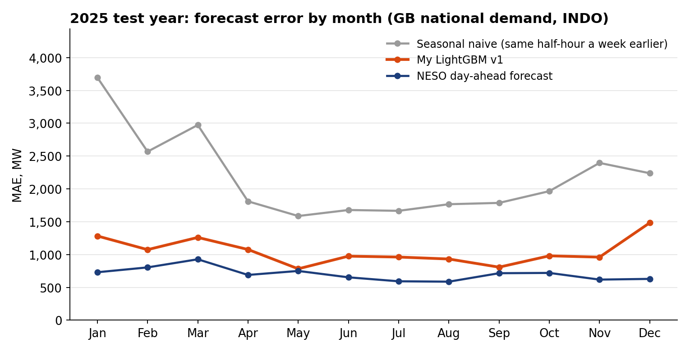
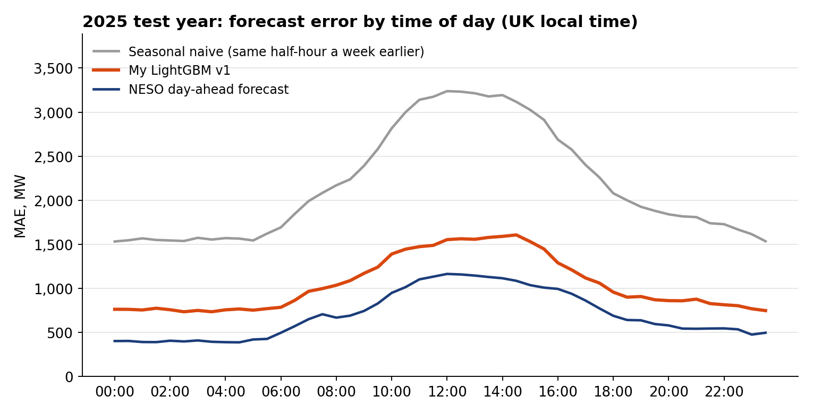

# GB power: battery dispatch and day-ahead demand forecasting

Two tested pieces of a GB power-trading toolkit, built on public data:

- **Battery dispatch (Session 1):** the most a 1 MW / 2 MWh battery could have earned on 2025 GB Market Index prices with perfect foresight, solved as an LP and a MIP in Pyomo with HiGHS.
- **Day-ahead demand forecast (Session 2):** a LightGBM forecast of GB national demand, issued at 09:30 the day before using only data published by then, and scored against a seasonal naive and NESO's own day-ahead forecast.

## Headline results

| | Result | How to read it |
|---|---|---|
| **Demand forecast**, 2025 test year, scored once | MAE **1,049 MW**, against 2,177 MW for the seasonal naive and 701 MW for NESO | Closes **76%** of the gap from the naive to NESO. NESO is still significantly better (Diebold-Mariano p < 0.001) |
| **Battery**, 2025, MIP | **£44,831 per MW per year** | An upper bound: perfect foresight, Market Index prices, no degradation cost, no balancing or ancillary revenue |

## Session 1: battery dispatch

### Formulation

Each settlement day is solved on its own: $`N \in \{46, 48, 50\}`$ settlement periods (clock-change days have 46 or 50), each $`\Delta t = 0.5`$ h.

| Symbol | Meaning | Value |
|---|---|---|
| $`p_t`$ | Market Index price, £/MWh | data |
| $`Z`$ | periods with no traded volume, so no price | data |
| $`P^{max}`$ | power rating | 1 MW |
| $`E^{max}`$ | energy capacity | 2 MWh |
| $`\eta_c, \eta_d`$ | charge and discharge efficiency | $`\sqrt{0.88}`$ each, so 88% round trip |
| $`e_0`$ | starting state of charge | 1 MWh, half full |
| $`n`$ | daily cycle cap, optional | 1, 1.5 or 2 |

Variables: charge $`c_t`$ and discharge $`d_t`$ (MW, grid side), state of charge $`e_t`$ (MWh), and in the MIP only a mode binary $`u_t`$.

```math
\max \sum_{t \notin Z} p_t \,(d_t - c_t)\,\Delta t
```

subject to

```math
\begin{aligned}
&(1)\quad e_t = e_{t-1} + \Big(\eta_c c_t - \frac{d_t}{\eta_d}\Big)\Delta t &&\text{state of charge, from } e_0\\
&(2)\quad 0 \le e_t \le E^{max} &&\text{energy limits}\\
&(3)\quad 0 \le c_t \le P^{max}, \quad 0 \le d_t \le P^{max} &&\text{power limits}\\
&(4)\quad e_N = e_0 &&\text{end the day where it started}\\
&(5)\quad c_t \le P^{max} u_t, \quad d_t \le P^{max}(1 - u_t), \quad u_t \in \{0, 1\} &&\text{MIP only: one mode per period}\\
&(6)\quad \sum_t \frac{d_t}{\eta_d}\,\Delta t \le n\,E^{max} &&\text{optional daily cycle cap}\\
&(7)\quad c_t = d_t = 0 \quad \forall t \in Z &&\text{no price, no trade}
\end{aligned}
```

### Results, 2025

| Case | £/MW/yr | Cycles per day |
|---|---|---|
| LP | 44,920 | 2.15 |
| MIP, no cap | 44,831 | 2.06 |
| MIP, at most 2 cycles a day | 44,203 | 1.83 |
| MIP, at most 1.5 cycles a day | 41,456 | 1.46 |
| MIP, at most 1 cycle a day | 35,666 | 1.00 |

- **The value of extra cycling falls fast:** £34.61 per extra cycle going from a 1-cycle to a 1.5-cycle cap, £20.46 from 1.5 to 2, and £7.31 beyond 2. That is the number to set against a warranty's cycle limit or a degradation cost.
- **The LP overstates revenue by £88.61/MW/yr,** on 34 of the 365 days. When prices are negative, the LP charges and discharges in the same period, burning energy through losses to be paid for consuming. The mode binary in (5) blocks this. A hand-solved test case caught it before it showed up in real data.
- **Data quality:** 11 of the 17,520 half-hours, on 4 days, had no traded volume, and Elexon reports a £0 placeholder price there. The model idles in those periods (constraint 7), so its value for those days is a lower bound. Taking the £0 at face value would have added £212/MW/yr.

Per-day results are in [`results/battery_2025_by_day.csv`](results/battery_2025_by_day.csv).

### What this number is not

- **Not the day-ahead auction.** The Market Index (MID, from APX) is a volume-weighted index of short-term exchange trades.
- **Not achievable in practice.** Perfect foresight makes it an upper bound. How much of it a real forecast captures is the next step.
- **Not continuous across days.** Each day starts and ends half full, so there is no arbitrage across midnight.
- **Not the full revenue stack.** It has no degradation cost, no Balancing Mechanism or ancillary revenue, no imbalance exposure and no market impact: the battery is a price-taker.

### How it is checked

- **Hand-solved cases** in `test_battery.py`: a spread that beats losses and one that doesn't (A), a binding energy limit (B), the negative-price LP artefact (C), the cycle cap (D) and a period with no price (E).
- **Runtime checks on every real solve** (`check_solution`): power and energy bounds, the state-of-charge path rebuilt from $`c`$ and $`d`$, the energy identity $`\sum d_t = \eta_c \eta_d \sum c_t`$, a finite and non-negative revenue, no simultaneous charging and discharging in the MIP, the cycle cap, and no trading in periods without a price.
- **Clock-change days**, with 46 and 50 periods, are tested.

## Session 2: day-ahead demand forecast

### The question

At **09:30 on D−1**, forecast GB national demand (INDO, in MW) for every settlement period of day D, using only data published by 09:30.

### The contestants

| Forecaster | Role |
|---|---|
| Seasonal naive: the same local half-hour a week earlier | The floor |
| NESO's day-ahead forecast: its last version published by 09:30 | The benchmark |
| LightGBM v1: calendar, lagged demand and weather forecasts | Mine. It never sees NESO's forecast |

### Point-in-time rules

- **Demand** is known up to D−2 at issue time.
- **Weather** is the forecast made 48 hours before each half-hour. Reanalysis (observed) weather is used only for training rows and for D−7, which is already history at issue time.
- **NESO** is graded on the version that was public by 09:30, the same cut-off my model gets.
- **Clock changes:** days with 46 and 50 periods are handled throughout, and the naive matches on local clock time.

### Protocol

- Forecasts are issued daily and the model is refitted monthly, on an expanding window from 2022.
- **2024 is the validation year:** three versions were tried there. **2025 is the test year:** v1 was frozen and scored once.
- The SQLite store refuses to score a version on 2025 unless that exact configuration ran on 2024, and it never overwrites stored forecasts. **It locks the configuration, not the source code,** so a code change between the two years would not be caught. Hashing the source into the configuration comes before the live runs start.

### Validation: three versions on 2024

| Version | Adds | MAE, MW | Share of the naive-to-NESO gap closed |
|---|---|---|---|
| v0 | calendar and lagged demand | 1,468 | 30% |
| v1 | weather forecasts | 981 | 71% |
| v2 | demand on D−1 up to 08:00 | 982 | 70% |

All three are scored on the same half-hours, March to December 2024. v2 added nothing, so it was recorded as a null result and v1 was frozen.

### Test: 2025, scored once

| Forecaster | MAE | RMSE | Bias | MASE | Skill vs naive |
|---|---|---|---|---|---|
| Seasonal naive | 2,177 | 2,920 | +42 | 1.08 | 0 |
| NESO | 701 | 977 | −39 | 0.35 | 0.68 |
| LightGBM v1 | 1,049 | 1,382 | −170 | 0.52 | 0.52 |

In MW, over all 17,520 half-hours of 2025. Bias is actual minus forecast, so v1's −170 MW means it forecast too high on average. MASE divides by the naive's MAE over 2022–2024.

Summary tables for every version and year are in [`results/`](results/).

- **Significance:** a Diebold-Mariano test on daily mean absolute error, so that correlated half-hours aren't counted as independent observations, over 365 days. v1 beats the naive and NESO beats v1, both with p < 0.001.
- **No sign of overfitting the validation year.** On the same months (March to December), v1's MAE rose 4.3% from 2024 to 2025, against 10.3% for NESO and 8.4% for the naive. Its share of the gap closed went from 71% to 74%.
- **Weather isn't the main gap.** Fed the actual weather, v1's MAE would have been 984 MW, so weather-forecast error explains 65 of the 348 MW between v1 and NESO.





- **December is v1's worst month:** 1,483 MW, against 629 MW for NESO. The holiday period is the first place to look.
- **All three forecasters do worst around midday.** INDO is demand as the transmission grid sees it, after embedded solar, so midday demand likely carries the solar forecast's error.

## Reproduce

```bash
pip install -r requirements.txt
python -m pytest            # hand-solved and synthetic test cases
python run_day.py           # Session 1: three real days, LP and MIP
python run_year.py          # Session 1: the 2025 year (the first run fetches prices into data/)
python run_session2.py      # Session 2: set YEAR = 2024 first, then 2025 (see its docstring)
```

- **Tested on Python 3.13.5** with the versions pinned in `requirements.txt`.
- **The data isn't in the repo.** Each script fetches what it needs on its first run and caches it in `data/`. Session 2's first run fetches four years of demand, forecasts and weather.
- **Run Session 2 on 2024 first.** The store won't score 2025 until the same configuration has run on 2024.

## Code map

| File | Session | What it does |
|---|---|---|
| `battery.py` | 1 | The LP and MIP, the HiGHS call and the runtime checks |
| `elexon.py` | 1, 2 | Elexon API: MID prices, INDO demand and NESO's NDF forecasts, plus settlement-period clock rules |
| `run_day.py` | 1 | Three real days: an ordinary one and both clock changes |
| `run_year.py` | 1 | The full 2025 year and the cycle-cap sweep |
| `gbtime.py` | 2 | Issue times and the settlement-period grid |
| `pit.py` | 2 | Picks the NESO forecast that was public by 09:30 |
| `weather.py` | 2 | Open-Meteo forecasts and reanalysis, weighted into national half-hourly weather |
| `naive.py` | 2 | The seasonal naive |
| `gbm.py` | 2 | Feature sets v0 to v2 and the LightGBM settings |
| `backtest.py` | 2 | The rolling-origin backtest: daily issue, monthly refit |
| `store.py` | 2 | SQLite store: append-only forecasts, the protocol lock, and a 28-day rolling MAE as a SQL window function |
| `score.py`, `evaluate.py` | 2 | Metrics, breakdowns and the Diebold-Mariano test |
| `run_session2.py` | 2 | The Session 2 pipeline |
| `synthetic.py` | tests | Synthetic data for the Session 2 tests |
| `test_*.py` | | The pytest suite |

## Limitations and next steps

- **Next, Session 3: what forecast skill is worth.** A demand forecast doesn't price anything by itself, so this needs a price model first. The battery then dispatches on forecast prices, settles at actual prices, and reports the share of perfect-foresight revenue it captured.
- **Next, Session 4: a scheduled daily run.** It will fetch, forecast, store and grade yesterday, and fail loudly on a missing settlement period. Each forecast will be committed before its delivery day.
- **The protocol lock covers the configuration, not the code** (see Protocol).
- **v1's bias changed sign between years:** +118 MW on 2024 (too low), −170 MW on 2025 (too high).

## Data and licences

- **Elexon** (Insights API, no key needed): MID prices, INDO demand and NESO's day-ahead national demand forecast (NDF). Contains BMRS data © Elexon Limited copyright and database right 2026. [Licence](https://www.elexon.co.uk/data/balancing-mechanism-reporting-agent/copyright-licence-bmrs-data/).
- **Open-Meteo:** ERA5 reanalysis and archived ECMWF forecasts. Weather data by [Open-Meteo.com](https://open-meteo.com/), under [CC BY 4.0](https://creativecommons.org/licenses/by/4.0/). Changes: site values are weighted into a national average and interpolated to half-hours.
- No endorsement by Elexon, NESO or Open-Meteo is implied.
- **Code:** MIT licence, see `LICENSE`.

## How this was built

Built with Claude (Anthropic) as a coding assistant.
